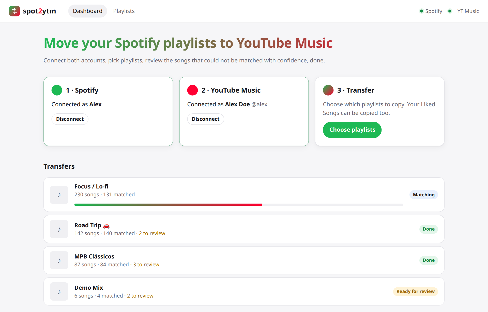
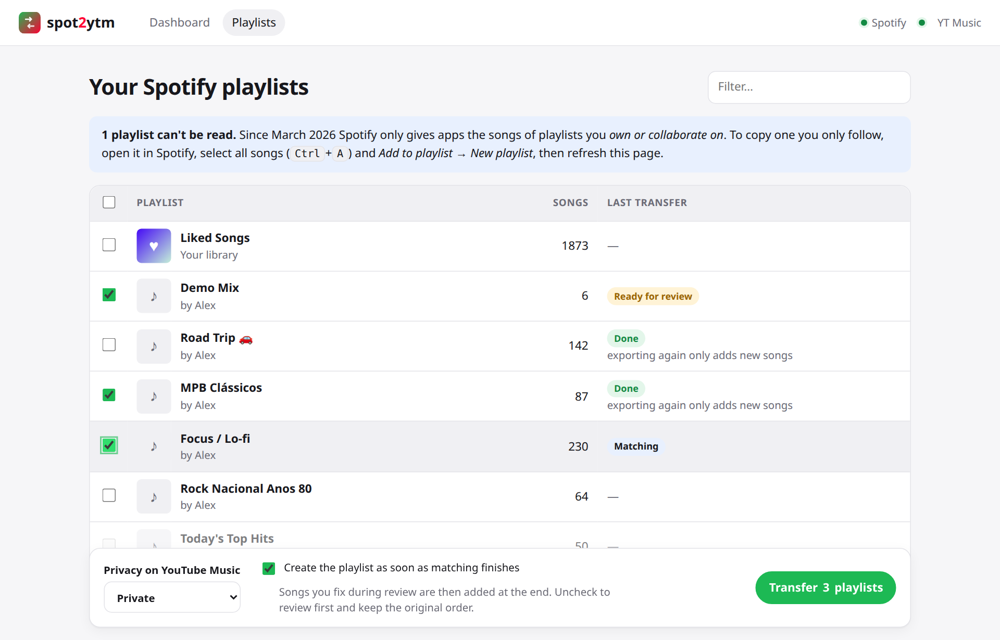
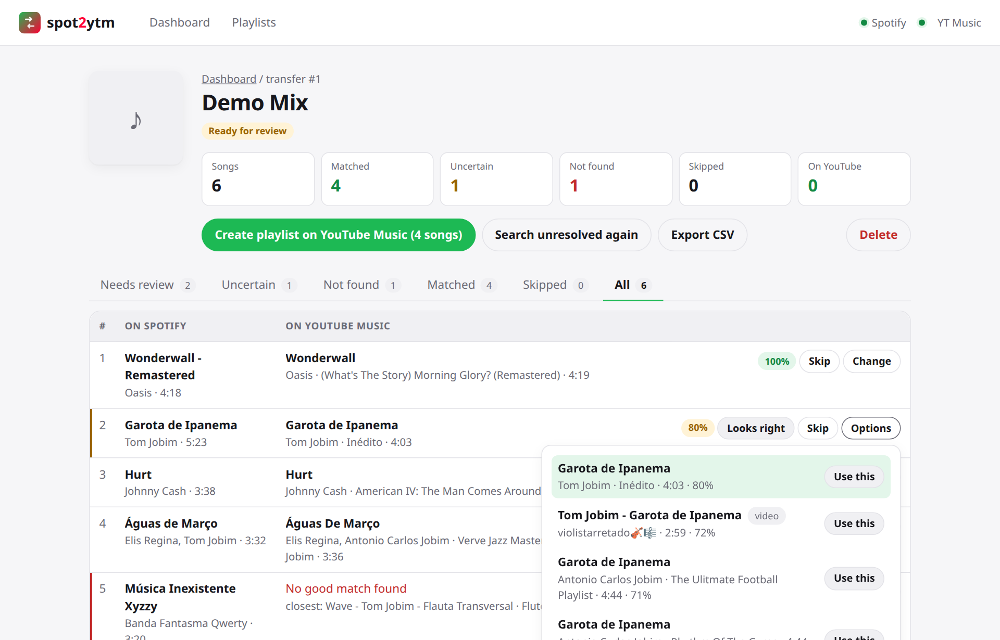
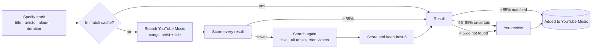

<div align="center">


# spot2ytm

**Move your Spotify playlists to YouTube Music, with a web UI that lets you review every uncertain match.**

[](https://github.com/dgolveira/spot2ytm/actions/workflows/ci.yml)
[](https://github.com/dgolveira/spot2ytm/actions/workflows/codeql.yml)
[](pyproject.toml)
[](LICENSE)
[](SECURITY.md)

[Features](#-features) ·
[Quick start](#-quick-start) ·
[Setup](#-connecting-your-accounts) ·
[How it works](#-how-matching-works) ·
[FAQ](#-faq) ·
[🇧🇷 Leia em português](README.pt-BR.md)

<br>

<picture>
  <source media="(prefers-color-scheme: dark)" srcset="docs/screenshots/dashboard-dark.png">
  
</picture>

</div>

---

## ✨ Features

- 🎧 **All your playlists**: the ones you created, the ones you collaborate on, and your **Liked Songs**.
- 🧠 **Smart matching**: compares title, artists, duration and *version*, so you get the studio recording instead of a live take, a karaoke or a sped-up edit.
- 🔍 **Review screen**: confident matches go straight in. Uncertain ones are shown side by side with alternatives, and you can accept, pick another version, search by hand or skip.
- 🔁 **Re-export safely**: exporting the same playlist again only adds the new songs to the same YouTube Music playlist. No duplicates.
- 💾 **Remembers everything**: a local match cache means a song is searched once, and your manual choices are reused in every playlist.
- ⏯️ **Resumable**: transfers run in the background. Close the app halfway and it picks up where it stopped.
- 📄 **CSV export** of every transfer, including what was not found.
- 🔒 **Private by design**: runs on your machine, Spotify access is read-only, nothing goes to third-party servers.
- 🌗 Light and dark themes, works on mobile.

## 📸 Screenshots

<table>
  <tr>
    <td width="50%">
      <picture>
        <source media="(prefers-color-scheme: dark)" srcset="docs/screenshots/playlists-dark.png">
        
      </picture>
      <p align="center"><b>Pick playlists</b>: Liked Songs included, filter and select many at once</p>
    </td>
    <td width="50%">
      <picture>
        <source media="(prefers-color-scheme: dark)" srcset="docs/screenshots/review-dark.png">
        
      </picture>
      <p align="center"><b>Review matches</b>: confidence score, alternatives and manual search</p>
    </td>
  </tr>
</table>

## 🚀 Quick start

### Option A: Python (3.11+)

```bash
git clone https://github.com/dgolveira/spot2ytm.git
cd spot2ytm
python -m venv .venv
source .venv/bin/activate        # Windows: .venv\Scripts\activate
pip install .
spot2ytm
```

Your browser opens at **http://127.0.0.1:8000**. Follow the three steps on the dashboard.

### Option B: Docker

```bash
git clone https://github.com/dgolveira/spot2ytm.git
cd spot2ytm
docker compose up -d
```

Then open **http://127.0.0.1:8000**. Your data is kept in `./data`.

> [!IMPORTANT]
> Use `127.0.0.1`, **not** `localhost`, in the Spotify redirect URI below.
> Spotify rejects `localhost` redirect addresses and only accepts loopback ones written as an IP.

## 🔑 Connecting your accounts

You do this once. Both steps are explained on screen, too.

### 1. Spotify (about 2 minutes)

Spotify only lets apps read your library through a developer app that **you** own. It is free.

1. Go to the [Spotify Developer Dashboard](https://developer.spotify.com/dashboard) and click **Create app**.
2. Give it any name and description.
3. Under **Redirect URIs** add exactly:
   ```
   http://127.0.0.1:8000/auth/spotify/callback
   ```
4. Under **Which API/SDKs are you planning to use?** tick **Web API**, accept the terms and save.
5. Open the app's **Settings**, copy the **Client ID** and paste it into spot2ytm.

That's all. No client secret is needed: spot2ytm uses the [PKCE flow](https://developer.spotify.com/documentation/web-api/tutorials/code-pkce-flow).

> [!NOTE]
> Spotify's Development Mode requires the app owner to have **Spotify Premium**, and allows up to 5 users per app.

### 2. YouTube Music

YouTube Music has no public API for managing playlists, so spot2ytm uses [ytmusicapi](https://github.com/sigma67/ytmusicapi) with the headers of your logged-in browser session.

1. Open [music.youtube.com](https://music.youtube.com) and make sure you are logged in.
2. Open the developer tools (<kbd>F12</kbd>) → **Network** tab and type `browse` in the filter.
3. Click around the page (e.g. **Library**) so a `POST` request to `browse?…` appears, and click it.
4. Copy its **request headers**:
   - **Chrome / Edge**: *Headers → Request Headers*, select everything and copy.
   - **Firefox**: right-click the request → *Copy Value → Copy Request Headers*.
5. Paste them into spot2ytm and click **Connect**.

The headers last as long as that browser session (they become invalid if you log out of YouTube Music in that browser).

### 3. Transfer

Open **Playlists**, tick the ones you want, choose the privacy for the new playlists (private by default) and click **Transfer**.

## 🧠 How matching works



Each candidate gets a score from 0 to 100%:

| Signal | Weight | Details |
|---|---|---|
| Title | 50% | Accent- and case-insensitive, ignoring `feat.`, `Remastered 2011`, `(Official Video)`… |
| Artists | 30% | Best match for the main artist, also handling merged `A & B` artists and `- Topic` / `VEVO` channels |
| Duration | 20% | Full points within 3 s, falling to zero at 30 s of difference |
| Version | penalty | `live`, `remix`, `acoustic`, `instrumental`, `karaoke`, `cover`, `sped up`, `slowed`, `8D`… lose points when the Spotify title does not have them |
| Album | small bonus | Same album name |

Official audio tracks are preferred over music videos when both exist.

## ⚙️ Configuration

Everything works out of the box. To change something, copy [`.env.example`](.env.example) to `.env`:

| Variable | Default | Description |
|---|---|---|
| `SPOT2YTM_SPOTIFY_CLIENT_ID` | *(set in the UI)* | Client ID of your Spotify app |
| `SPOT2YTM_DATA_DIR` | `data` | Where tokens, headers and the database are stored |
| `SPOT2YTM_HOST` | `127.0.0.1` | Interface to listen on |
| `SPOT2YTM_PORT` | `8000` | Port to listen on |
| `SPOT2YTM_BASE_URL` | `http://127.0.0.1:<port>` | URL used in the browser. The Spotify redirect URI is built from it |
| `SPOT2YTM_ALLOWED_HOSTS` | | Extra accepted `Host` names, comma separated |
| `SPOT2YTM_SEARCH_DELAY` | `0.2` | Pause between YouTube Music searches, in seconds |

Command line options: `spot2ytm --port 9000 --no-browser`.

If you change the port, register the matching redirect URI (`http://127.0.0.1:9000/auth/spotify/callback`) in your Spotify app.

## ❓ FAQ

<details>
<summary><b>Some of my playlists say "followed only, songs not available"</b></summary>

Since March 2026 the Spotify API only returns the songs of playlists you **own or collaborate on**. For a playlist you only follow (including Spotify's editorial ones), open it in Spotify, select all songs (<kbd>Ctrl</kbd>+<kbd>A</kbd> / <kbd>Cmd</kbd>+<kbd>A</kbd>), right-click → *Add to playlist → New playlist*, and refresh spot2ytm.
</details>

<details>
<summary><b>Will it create duplicates if I run it twice?</b></summary>

No. spot2ytm remembers which YouTube Music playlist each Spotify playlist went to, checks what is already there and only adds what is missing. If you deleted the playlist on YouTube Music, a new one is created.
</details>

<details>
<summary><b>Does it change anything on my Spotify account?</b></summary>

No. It only requests read-only scopes (`playlist-read-private`, `playlist-read-collaborative`, `user-library-read`).
</details>

<details>
<summary><b>How long does it take?</b></summary>

About 1 second per song the first time (one or two searches each). Songs already in the match cache are instant. A 500-song playlist takes around 8 minutes. You can transfer several playlists at once: they are processed one after the other.
</details>

<details>
<summary><b>Will the song order be kept?</b></summary>

Yes for everything added in one go. If *Create the playlist as soon as matching finishes* is on, songs you fix later in the review screen are appended at the end. Turn it off to review first and keep the exact order.
</details>

<details>
<summary><b>"YouTube Music rejected these headers"</b></summary>

Copy the headers again from a `POST` request to `browse` made **while logged in**, and make sure the paste includes the `cookie` and `x-goog-authuser` lines. Using a private window can help: log in there, copy the headers and close the window without logging out.
</details>

<details>
<summary><b>"INVALID_CLIENT: Invalid redirect URI" on Spotify</b></summary>

The redirect URI in your Spotify app must be **exactly** the one shown on spot2ytm's Spotify setup page, including `http://`, `127.0.0.1`, the port and `/auth/spotify/callback`.
</details>

<details>
<summary><b>Can I host it on a server for friends?</b></summary>

It is not designed for that: it has no login of its own and holds the credentials of one person. Keep it on your machine. See [SECURITY.md](SECURITY.md).
</details>

## 🏗️ Architecture

```
spot2ytm/
├── spotify.py     Spotify Web API client: OAuth PKCE, playlists, Liked Songs
├── ytm.py         YouTube Music access through ytmusicapi
├── matching.py    Normalisation and scoring of search results
├── jobs.py        Background worker: fetch → match → (review) → push
├── db.py          SQLite: transfers, tracks, match cache, playlist links
├── web.py         FastAPI routes and htmx endpoints
├── templates/     Jinja2 pages and partials
└── static/        CSS, a little JS and htmx
```

Built with [FastAPI](https://fastapi.tiangolo.com/), [htmx](https://htmx.org/), [ytmusicapi](https://github.com/sigma67/ytmusicapi), [RapidFuzz](https://github.com/rapidfuzz/RapidFuzz) and SQLite. No JavaScript build step, no external services.

## 🧪 Development

```bash
pip install -e ".[dev]"
pytest
```

The tests use in-memory fakes for both services, so they run offline in under a second. See [CONTRIBUTING.md](CONTRIBUTING.md) for the details.

## 🔒 Security

- Listens on `127.0.0.1` only, rejects unknown `Host` headers and cross-site form posts.
- Spotify: OAuth with PKCE, read-only scopes, no client secret stored.
- Credentials are stored in `data/` with `0600` permissions and only sent to Spotify and YouTube Music.
- Every change is checked by **CodeQL**, **pip-audit** and **Dependabot**.

Found a vulnerability? Please report it privately, as described in [SECURITY.md](SECURITY.md).

## 🤝 Contributing

Contributions are welcome, especially cases where the matcher picks the wrong song. Open an issue with the
[wrong match template](https://github.com/dgolveira/spot2ytm/issues/new?template=wrong_match.yml) or read
[CONTRIBUTING.md](CONTRIBUTING.md) to send a pull request.

## 📜 License

[MIT](LICENSE) © Douglas Oliveira. Third-party components are listed in [THIRD_PARTY_NOTICES.md](THIRD_PARTY_NOTICES.md).

> [!NOTE]
> spot2ytm is an independent project, not affiliated with, endorsed or sponsored by Spotify or Google.
> Spotify is a trademark of Spotify AB; YouTube and YouTube Music are trademarks of Google LLC.
> YouTube Music access relies on the unofficial ytmusicapi library. Use it responsibly and at your own risk.
