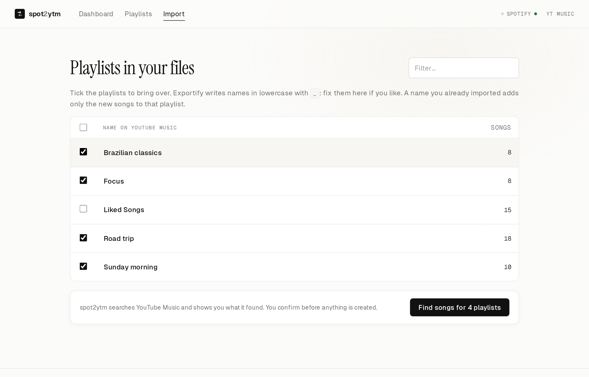
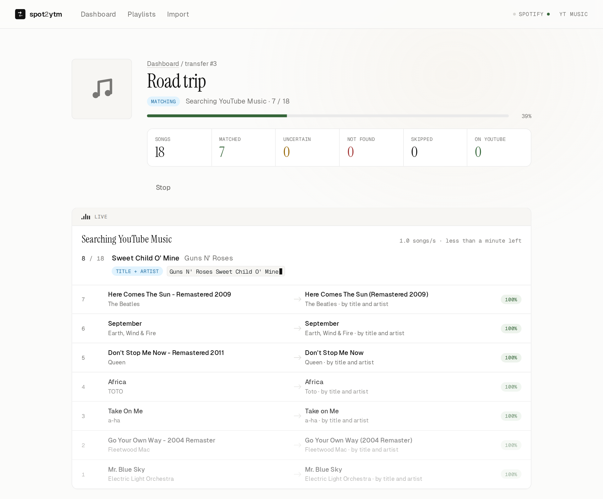
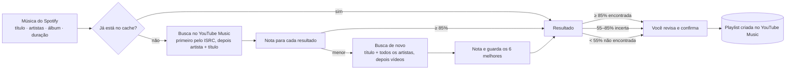

<div align="center">


# spot2ytm

**Leve suas playlists do Spotify para o YouTube Music, com uma interface web onde você revisa cada correspondência duvidosa.**

[](https://github.com/dgolveira/spot2ytm/actions/workflows/ci.yml)
[](https://github.com/dgolveira/spot2ytm/actions/workflows/codeql.yml)
[](pyproject.toml)
[](LICENSE)

[Recursos](#recursos) ·
[Começando](#começando) ·
[Configurar contas](#conectando-suas-contas) ·
[Como funciona](#como-a-correspondência-funciona) ·
[Dúvidas](#dúvidas-frequentes) ·
[Read in English](README.md)

<br>

<picture>
  <source media="(prefers-color-scheme: dark)" srcset="docs/screenshots/dashboard-dark.png">
  
</picture>

</div>

---

## Recursos

- **Todas as suas playlists**: as que você criou, as colaborativas e as suas **Músicas Curtidas**.
- **Funciona com Spotify Free**: envie os arquivos salvos pelo [Exportify](https://exportify.app) (todas as playlists e as Curtidas), ou cole o link da playlist ou os links das músicas copiados do app do Spotify.
- **Correspondência inteligente**: compara título, artistas, duração e *versão*. Você recebe a gravação de estúdio, e não a ao vivo, o karaokê ou a versão acelerada.
- **Nada acontece sem você ver**: o spot2ytm busca, mostra o que encontrou e espera. Você confere as músicas e confirma antes de qualquer playlist ser criada no YouTube Music.
- **Tela de revisão**: o que é duvidoso aparece lado a lado com alternativas, e você aceita, escolhe outra versão, busca na mão ou pula.
- **Exportar de novo sem medo**: exportar a mesma playlist outra vez só adiciona as músicas novas na mesma playlist do YouTube Music. Sem duplicatas.
- **Lembra de tudo**: com o cache local, cada música é buscada uma vez só, e suas escolhas manuais valem para todas as playlists.
- **Progresso ao vivo**: enquanto trabalha, a página da transferência mostra a música que está sendo buscada, qual busca está sendo tentada (ISRC, título e artista, vídeos), as últimas músicas com o que foi encontrado e o tempo restante.
- **Retomável**: as transferências rodam em segundo plano. Se fechar o app no meio, ele continua de onde parou.
- **Exportação em CSV** de cada transferência, incluindo o que não foi encontrado.
- **Privado**: roda na sua máquina, o acesso ao Spotify é só leitura e nada passa por servidores de terceiros.
- Tema claro e escuro, e funciona no celular.

## Telas

<table>
  <tr>
    <td width="50%">
      <picture>
        <source media="(prefers-color-scheme: dark)" srcset="docs/screenshots/import-dark.png">
        
      </picture>
      <p align="center"><b>Escolha as playlists</b>: tudo o que está nos arquivos do Exportify, com nomes que você pode corrigir</p>
    </td>
    <td width="50%">
      <picture>
        <source media="(prefers-color-scheme: dark)" srcset="docs/screenshots/live-dark.png">
        
      </picture>
      <p align="center"><b>Acompanhe a busca</b>: a música, a pesquisa exata, o que foi encontrado e o tempo restante</p>
    </td>
  </tr>
  <tr>
    <td colspan="2">
      <picture>
        <source media="(prefers-color-scheme: dark)" srcset="docs/screenshots/review-dark.png">
        
      </picture>
      <p align="center"><b>Revise e confirme</b>: nota de confiança, alternativas e busca manual</p>
    </td>
  </tr>
</table>

## Começando

### Opção A: Python (3.11+)

```bash
git clone https://github.com/dgolveira/spot2ytm.git
cd spot2ytm
python -m venv .venv
source .venv/bin/activate        # Windows: .venv\Scripts\activate
pip install .
spot2ytm
```

O navegador abre em **http://127.0.0.1:8000**. Siga os três passos do painel.

### Opção B: Docker

```bash
git clone https://github.com/dgolveira/spot2ytm.git
cd spot2ytm
docker compose up -d
```

Depois abra **http://127.0.0.1:8000**. Os dados ficam em `./data`, e os logs saem com `docker compose logs -f`.
No Docker o app não consegue ler os cookies do navegador, então conecte o YouTube Music colando os cabeçalhos.

> [!IMPORTANT]
> Na redirect URI do Spotify, use `127.0.0.1`, **e não** `localhost`.
> O Spotify recusa `localhost` e só aceita endereços locais escritos como IP.

## Conectando suas contas

Você faz isso uma vez só, e a própria tela explica cada passo.

### 1. Spotify

Há três jeitos de ler suas músicas. Escolha um:

| | Arquivos do Exportify (Free ou Premium) | Login (Premium) | Links (Free ou Premium) |
|---|---|---|---|
| Precisa de | Entrar no exportify.app | Spotify Premium e um app de desenvolvedor | Nada |
| Curtidas | Sim | Sim | Colando os links das músicas |
| Limites | Nenhum | Só playlists que você criou ou em que colabora | Link de playlist lê as primeiras 100 músicas |

#### Arquivos do Exportify (recomendado no Spotify Free)

O [Exportify](https://exportify.app) é um site de código aberto ([MIT](https://github.com/watsonbox/exportify)) aprovado pelo Spotify, então consegue ler todas as playlists e as Curtidas de qualquer conta.

1. Abra o [exportify.app](https://exportify.app), entre com o Spotify e clique em **Export** ao lado de uma playlist (ou em **Export All** para baixar um .zip com todas).
2. No spot2ytm, abra **Import**, envie os arquivos .csv ou .zip, marque as playlists, ajuste os nomes se quiser (o Exportify escreve em minúsculas com `_`) e clique em **Transfer**.

Os arquivos trazem o ISRC de cada música, o código da gravação exata, que o spot2ytm procura primeiro no YouTube Music.

#### Importar com links (sem login)

Abra **Import** no spot2ytm e cole:

- **o link de uma playlist ou álbum público** (*Compartilhar → Copiar link* no Spotify). A página pública do Spotify só lista as primeiras 100 músicas; ou
- **as próprias músicas**: abra a playlist (ou as Curtidas) no app do Spotify no computador, clique numa música e aperte <kbd>Ctrl</kbd>+<kbd>A</kbd> e depois <kbd>Ctrl</kbd>+<kbd>C</kbd> (<kbd>Cmd</kbd> no Mac). Isso copia um link por música, sem limite, e funciona também com playlists privadas.

O spot2ytm lê as páginas públicas do player embutido do Spotify, sem login nem token. Depois, siga para o passo 2.

#### Login (Premium, uns 2 minutos)

O Spotify só deixa apps lerem sua biblioteca por meio de um app de desenvolvedor que seja **seu**, e só se a conta tiver Premium.

1. Entre no [Spotify Developer Dashboard](https://developer.spotify.com/dashboard) e clique em **Create app**.
2. Dê qualquer nome e descrição.
3. Em **Redirect URIs**, adicione exatamente:
   ```
   http://127.0.0.1:8000/auth/spotify/callback
   ```
4. Em **Which API/SDKs are you planning to use?**, marque **Web API**, aceite os termos e salve.
5. Abra **Settings** do app, copie o **Client ID** e cole no spot2ytm.

Só isso. Não precisa de client secret, porque o spot2ytm usa o [fluxo PKCE](https://developer.spotify.com/documentation/web-api/tutorials/code-pkce-flow).

> [!NOTE]
> O modo de desenvolvimento do Spotify exige que o dono do app tenha **Spotify Premium** e permite até 5 usuários por app.
> Em conta Free a opção **Web API** fica desabilitada, e um app criado antes responde a toda consulta com
> `403 Active premium subscription required for the owner of the app`. O spot2ytm avisa isso no painel: clique em
> **Disconnect and remove app** e use os [arquivos do Exportify](#arquivos-do-exportify-recomendado-no-spotify-free).

### 2. YouTube Music

O YouTube Music não tem API pública para playlists, então o spot2ytm usa a [ytmusicapi](https://github.com/sigma67/ytmusicapi) com a sua sessão logada no navegador.

**Automático:** entre no [music.youtube.com](https://music.youtube.com) pelo navegador, escolha esse navegador no spot2ytm (Edge, Chrome, Firefox, Brave, Chromium, Opera ou Vivaldi) e clique em **Connect from browser**. O spot2ytm lê os cookies do YouTube desse navegador no seu computador, com o leitor de cookies do [yt-dlp](https://github.com/yt-dlp/yt-dlp).

- No Linux, os navegadores baseados no Chrome criptografam os cookies com uma chave guardada no chaveiro do sistema, então ele pode pedir para desbloquear o chaveiro. Se mais de um app (o VS Code, por exemplo) tiver salvo uma chave com o mesmo nome, o spot2ytm testa cada uma.
- No Windows, o Chrome e o Edge bloqueiam os cookies: use o Firefox ou cole os cabeçalhos à mão.
- Não funciona no Docker, onde não há navegador.

**À mão:**

1. Abra o [music.youtube.com](https://music.youtube.com) logado.
2. Abra as ferramentas de desenvolvedor (<kbd>F12</kbd>), vá na aba **Network** (Rede) e digite `browse` no filtro.
3. Clique em algo na página (por exemplo, **Biblioteca**) até aparecer uma requisição `POST` para `browse?…`, e clique nela.
4. Copie os **cabeçalhos da requisição** (request headers):
   - **Chrome / Edge**: em *Headers → Request Headers*, selecione tudo e copie.
   - **Firefox**: botão direito na requisição → *Copiar valor → Copiar cabeçalhos da requisição*.
5. Cole no spot2ytm e clique em **Connect**.

Os cabeçalhos valem enquanto durar a sessão do navegador. Se você sair da conta do YouTube Music naquele navegador, eles deixam de funcionar.

### 3. Transferir

1. Escolha as playlists: no **Import** (arquivo do Exportify ou links) ou, com login no Spotify, em **Playlists**. Clique em **Find songs**.
2. O spot2ytm busca no YouTube Music e para. Nada é criado ainda.
3. Confira o resultado: abra uma playlist para ver cada música ao lado do que foi encontrado e resolva as incertas.
4. Confirme: na página da playlist ou, para várias de uma vez, no quadro **Waiting for your confirmation** do Dashboard. Escolha a privacidade (privada por padrão) e clique em **Create**.

## Como a correspondência funciona



Quando a música tem ISRC (sempre nos arquivos do Exportify e com login no Spotify), a primeira busca usa esse código: o YouTube Music devolve exatamente aquela gravação como primeiro resultado, então a maioria das músicas é encontrada com uma busca só.

| Sinal | Peso | Detalhes |
|---|---|---|
| Título | 50% | Ignora acentos, maiúsculas, `feat.`, `Remastered 2011`, `(Official Video)`… |
| Artistas | 30% | Compara o artista principal e trata artistas juntos (`A & B`) e canais `- Topic` / `VEVO` |
| Duração | 20% | Nota cheia até 3 s de diferença, chegando a zero em 30 s |
| Versão | penalidade | `ao vivo`, `remix`, `acústico`, `instrumental`, `karaokê`, `cover`, `sped up`, `slowed`, `8D`… perdem pontos se o título no Spotify não tiver |
| Álbum | bônus | Mesmo nome de álbum |

Quando existem as duas opções, o áudio oficial tem preferência sobre o videoclipe.

## Configuração

Funciona sem configurar nada. Se quiser mudar algo, copie o [`.env.example`](.env.example) para `.env`:

| Variável | Padrão | Descrição |
|---|---|---|
| `SPOT2YTM_SPOTIFY_CLIENT_ID` | *(definido na tela)* | Client ID do seu app do Spotify |
| `SPOT2YTM_DATA_DIR` | `data` | Onde ficam tokens, cabeçalhos e o banco |
| `SPOT2YTM_HOST` | `127.0.0.1` | Interface em que o app escuta |
| `SPOT2YTM_PORT` | `8000` | Porta |
| `SPOT2YTM_BASE_URL` | `http://127.0.0.1:<porta>` | Endereço usado no navegador. A redirect URI do Spotify é montada a partir dele |
| `SPOT2YTM_ALLOWED_HOSTS` | | Nomes de `Host` extras aceitos, separados por vírgula |
| `SPOT2YTM_SEARCH_DELAY` | `0.2` | Pausa entre buscas no YouTube Music, em segundos |
| `SPOT2YTM_LOG_LEVEL` (ou `LOG_LEVEL`) | `info` | `trace`, `debug`, `info`, `warn`, `error`, `fatal` ou `silent` |
| `SPOT2YTM_LOG_FILE` | `<pasta de dados>/spot2ytm.log` | Também grava os logs nesse arquivo (rotaciona em 10 MB). Vazio para só stdout |

### Logs

Os logs são linhas JSON no formato do [pino](https://getpino.io) (`level` de 10 a 60, `time` em ms, `pid`, `hostname`, `name`, `msg` e erros em `err`), então as ferramentas do pino leem direto. Saem no stdout e em `data/spot2ytm.log`.

```bash
docker compose logs -f spot2ytm                  # acompanhar (Docker)
tail -f data/spot2ytm.log | npx pino-pretty      # legível
spot2ytm --log-level debug                       # inclui cada busca no YouTube Music
```

No nível `info` aparecem cada requisição e cada música assim que é processada (título, ISRC, status, nota e o que foi encontrado). O `debug` acrescenta cada busca e seus resultados. Credenciais, cookies e tokens nunca vão para o log.

## Dúvidas frequentes

<details>
<summary><b>Algumas playlists aparecem como "followed only, songs not available"</b></summary>

Desde março de 2026, a API do Spotify só devolve as músicas de playlists que você **criou ou em que colabora**. Para uma playlist que você só segue (inclusive as editoriais do Spotify), abra no Spotify, selecione todas as músicas (<kbd>Ctrl</kbd>+<kbd>A</kbd>), clique com o botão direito → *Adicionar à playlist → Nova playlist* e atualize o spot2ytm. Ou aperte <kbd>Ctrl</kbd>+<kbd>C</kbd> e cole as músicas em **Import**.
</details>

<details>
<summary><b>Rodar duas vezes cria duplicatas?</b></summary>

Não. O spot2ytm lembra para qual playlist do YouTube Music cada playlist foi, confere o que já está lá e só adiciona o que falta. Se você apagou a playlist no YouTube Music, ele cria outra.
</details>

<details>
<summary><b>Ele altera algo na minha conta do Spotify?</b></summary>

Não. Ele só pede permissões de leitura.
</details>

<details>
<summary><b>Quanto tempo demora?</b></summary>

Cerca de 1 segundo por música na primeira vez. As que já estão no cache são instantâneas. Uma playlist de 500 músicas leva uns 8 minutos.
</details>

<details>
<summary><b>A ordem das músicas é mantida?</b></summary>

Sim. O spot2ytm sempre mostra a revisão antes de criar a playlist, então tudo o que você aceitou entra de uma vez, na ordem do Spotify. Músicas corrigidas depois que a playlist já foi criada vão para o fim.
</details>

<details>
<summary><b>Posso hospedar num servidor para os amigos?</b></summary>

Não foi feito para isso: não tem login próprio e guarda as credenciais de uma pessoa. Deixe na sua máquina. Veja o [SECURITY.md](SECURITY.md).
</details>

## Contribuindo

Contribuições são bem-vindas, principalmente casos em que a música errada foi escolhida. Abra uma issue com o
[modelo de correspondência errada](https://github.com/dgolveira/spot2ytm/issues/new?template=wrong_match.yml) ou leia o
[CONTRIBUTING.md](CONTRIBUTING.md).

## Licença

[MIT](LICENSE) © Douglas Oliveira. Os componentes de terceiros estão listados em [THIRD_PARTY_NOTICES.md](THIRD_PARTY_NOTICES.md).

> [!NOTE]
> O spot2ytm é um projeto independente, sem vínculo, endosso ou patrocínio do Spotify ou do Google.
> Spotify é marca registrada da Spotify AB; YouTube e YouTube Music são marcas registradas da Google LLC.
> O acesso ao YouTube Music usa a biblioteca não oficial ytmusicapi. Use com responsabilidade e por sua conta e risco.
